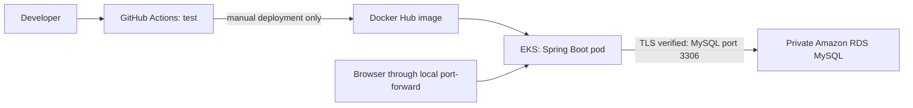

# Spring Boot + MySQL on RDS + Docker + EKS

This is a separate learning project based on your working `springboot-crud-k8s` application. The Java order controller, entity, repository and service are reused. MySQL moves to Amazon RDS; Kubernetes runs only the Spring Boot app. No AWS resources are created by building or pushing this repository.

**Start with [the complete walkthrough](docs/STEP-BY-STEP.md).** Open this directory's `pom.xml` in IntelliJ and select **Corretto 26** as the project and Maven SDK. Java 26 matches your existing project; this is not an LTS version. Plan supported Java/framework upgrades for a long-lived application.



## Run without AWS

Install Java 26, Maven and Docker Desktop; start Docker Desktop's Linux engine. In this directory:

```powershell
docker compose up -d --wait
mvn verify
mvn spring-boot:run
```

In a second terminal:

```powershell
$order = @{name='Watch'; qty=2; price=1499} | ConvertTo-Json
Invoke-RestMethod http://localhost:8080/orders -Method Post -ContentType 'application/json' -Body $order
Invoke-RestMethod http://localhost:8080/orders
```

Stop the app with Ctrl+C and local MySQL with `docker compose down`. The named local volume retains your learning records. `docker compose down -v` permanently removes those LOCAL records.

To build the deployable Docker image yourself (Python 3 and JDK keytool must be on PATH):

```powershell
mvn verify
python scripts/prepare-rds-truststore.py
docker build -t springboot-mysql-rds:local .
```

Do not run the container with its default local profile unless you configure a reachable MySQL host; inside a container, `localhost` refers to that container. The Kubernetes manifest explicitly selects the RDS profile and supplies its settings.

## What is included

* Original API: POST `/orders`, GET `/orders`, GET `/orders/{id}`. The original app has create/read operations; update/delete endpoints have not been invented here.
* Local MySQL Compose setup and isolated H2 automated tests; no AWS account needed for tests.
* RDS profile with certificate and hostname verification, bounded connection pool and required external credentials.
* Non-root Docker image and Kubernetes health checks. Readiness checks the database; liveness checks the application process.
* One learning replica and a free-of-load-balancer **ClusterIP** service. An optional public NLB manifest is separate and billable.
* GitHub workflow: automatic tests, explicit manual AWS deployment, immutable commit-tagged images.
* Database bootstrap SQL template; network, GitHub, troubleshooting, reuse and cleanup instructions.

## Important boundaries

RDS itself is not created yet. Nothing was deployed or deleted in your existing AWS account. This project does not import the old database records automatically. GitHub secrets must be entered in the new repository; existing repository secrets cannot be read back or transferred by this project.

The app deliberately preserves `ddl-auto: update` for learning. For production, use reviewed Flyway/Liquibase migrations, narrower runtime database permissions, authenticated HTTPS API access, managed secret rotation, tested restores and appropriate availability. One app replica and Single-AZ RDS are learning choices.

**Keeping an EKS cluster, EC2 nodes, NAT gateways, EBS or RDS resources can still incur charges even when you are not using the app.** See [the cost and cleanup checklist](docs/COST-AND-CLEANUP.md). IAM roles can be retained, but keeping a cluster is not a zero-cost pause.
